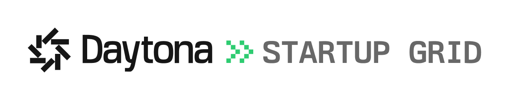
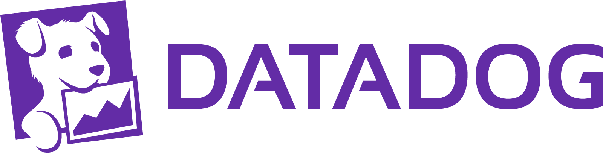

 

    <picture>
      <source media="(prefers-color-scheme: dark)" srcset="./assets/logo vitre terreux sans back.png">
      <source media="(prefers-color-scheme: light)" srcset="./assets/logo vitre terreux sans back.png">
      
    </picture> 
    
### ⟟₪  Đℝ∑⟑Mš  ₩€  ₸ℝ⊔$⟘

**Universus Technologies** · Québec, Canada 🍁

*We teach machines to listen, so that humanity doesn't have to write.*

---

Part alchemy, part architecture — compiling the improbable into production, and building the next universe because this one had too many bugs in the documentation.

Between a doctor's voice and the final report, there is a thin line of silence. We live there. We measure it in milliseconds, and we give it back as time.

---

### Standing on the shoulders of generous giants

A startup is a dream with a burn rate. Four companies decided ours was worth fueling with startup credits:

  <a href="https://www.cloudflare.com/startups/">
    <picture>
      <source media="(prefers-color-scheme: dark)" srcset="./assets/cloudflare-dark.png">
      <source media="(prefers-color-scheme: light)" srcset="./assets/cloudflare-light.png">
      
    </picture>
  </a>
  &nbsp;&nbsp;&nbsp;&nbsp;&nbsp;&nbsp;
  <a href="https://daytona.io/startups">
    <picture>
      <source media="(prefers-color-scheme: dark)" srcset="./assets/daytona-startup-grid-dark.png">
      <source media="(prefers-color-scheme: light)" srcset="./assets/daytona-startup-grid-light.png">
      
    </picture>
  </a>

  <a href="https://www.datadoghq.com/startups/">
    <picture>
      <source media="(prefers-color-scheme: dark)" srcset="./assets/datadog-dark.png">
      <source media="(prefers-color-scheme: light)" srcset="./assets/datadog-light.png">
      
    </picture>
  </a>
  &nbsp;&nbsp;&nbsp;&nbsp;&nbsp;&nbsp;
  <a href="https://startup.ovhcloud.com/">
    <!-- Generated badge until an official OVHcloud logo lands in profile/assets/ -->
    
  </a>

Thank you, [**Cloudflare for Startups**](https://www.cloudflare.com/startups/), [**Daytona Startup Grid**](https://daytona.io/startups), [**Datadog for Startups**](https://www.datadoghq.com/startups/) and [**OVHcloud Startup Program**](https://startup.ovhcloud.com/) — for the credits, and for betting on strangers.
